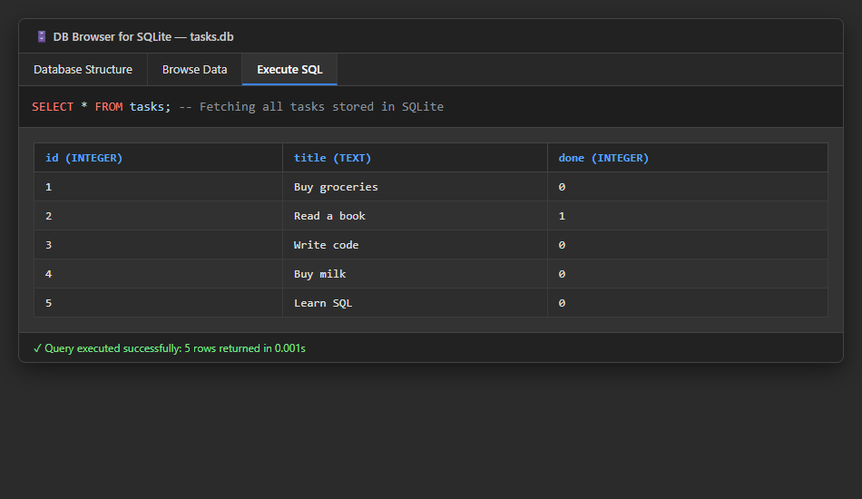
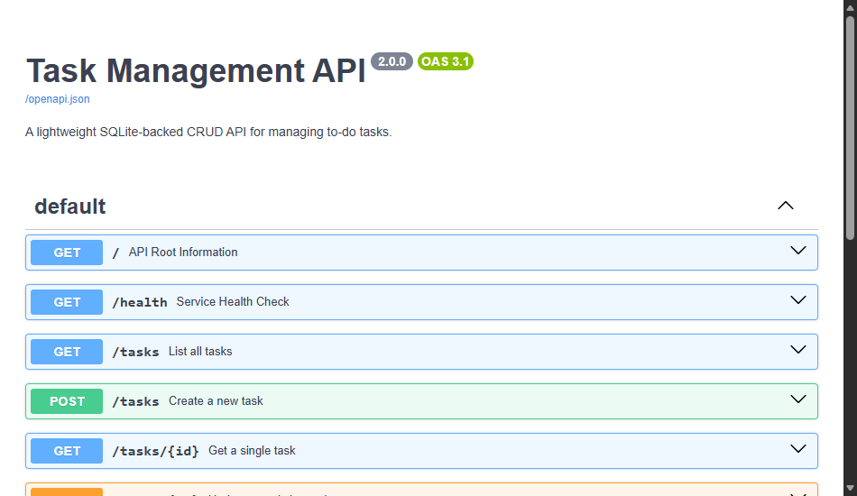

# Task Management CRUD API (SQLite Edition)

A production-style RESTful CRUD API built with **Python 3.13**, **FastAPI**, and **SQLite**. 

This project is the direct sequel to Assignment 1: the API endpoints remain identical, but storage has been migrated from volatile memory to an on-disk **SQLite database (`tasks.db`)**, ensuring that all task modifications survive server restarts.

---

## 🗄️ Why SQLite?

1. **Zero-Configuration & Serverless:** SQLite runs as an embedded engine within the Python process using the standard library `sqlite3` module. No external database servers (like MySQL or PostgreSQL), credentials, or daemon processes are required.
2. **Single-File Portability:** The entire database lives in a single local file (`tasks.db`).
3. **True Persistence:** Data survives server reboots, application crashes, and deployments.
4. **Automatic Provisioning:** If `tasks.db` or the `tasks` table does not exist, the server automatically provisions the schema and populates the 3 default seed tasks upon booting.
5. **Clean Clones:** `tasks.db` is included in `.gitignore` so each clean clone begins with a fresh, automatically provisioned database.

---

## 🚀 Quickstart (One Documented Command)

### 1. Prerequisites
- Python 3.10+ installed

### 2. Install Dependencies
```bash
pip install -r requirements.txt
```

### 3. Run the Server
Start the API with a single command:

```bash
python main.py
```

*(Alternatively, via Uvicorn CLI: `uvicorn main:app --reload --port 8000`)*

The server will automatically create `tasks.db`, create the `tasks` table, seed 3 initial tasks, and listen on `http://localhost:8000`.

---

## 📖 API Documentation & Endpoints

Interactive Swagger UI documentation is available at:
👉 **[http://localhost:8000/docs](http://localhost:8000/docs)**

### Endpoints Table

| Method | Endpoint | Description | Request Body | Success Status | Error Statuses |
| :--- | :--- | :--- | :--- | :--- | :--- |
| `GET` | `/` | API root metadata and discovery | None | `200 OK` | — |
| `GET` | `/health` | Server health check | None | `200 OK` | — |
| `GET` | `/tasks` | List all tasks (supports `done`, `search`, `sort`) | None | `200 OK` | — |
| `GET` | `/tasks/{id}` | Retrieve a single task by ID | None | `200 OK` | `404 Not Found` |
| `POST` | `/tasks` | Create a new task (defaults `done: false`) | `{"title": "Buy milk"}` | `201 Created` | `400 Bad Request` |
| `PUT` | `/tasks/{id}` | Update task title and/or done status | `{"title": "Updated", "done": true}` | `200 OK` | `400 Bad Request`, `404 Not Found` |
| `DELETE`| `/tasks/{id}` | Delete a task by ID (returns empty body) | None | `204 No Content`| `404 Not Found` |
| `GET` | `/stats` | Task statistics (`total`, `done`, `open`) via SQL `COUNT` | None | `200 OK` | — |
| `POST` | `/reset` | Clears and reseeds the 3 default tasks | None | `200 OK` | — |

---

## 🔎 Database Inspection & Stage 4 SQL by Hand

The database file `tasks.db` can be directly inspected using **DB Browser for SQLite**:



### Example SQL Query Executed in Stage 4:
```sql
SELECT COUNT(*) FROM tasks;
```
* **What it returned:** `5` (verifying that all inserted tasks were stored directly on disk in SQLite).
* **Direct Verification:** Calling `GET /tasks` from the API immediately reflected all manual database changes without needing to restart the server, proving that SQLite is the single source of truth.

---

## ⚡ SQL Filtering, Search & Sorting

The `GET /tasks` endpoint runs parameterized SQL queries under the hood:
- **Filtering by completion:** `GET /tasks?done=true` (`WHERE done = ?`)
- **Pattern Search:** `GET /tasks?search=milk` (`WHERE title LIKE ?`)
- **Alphabetical Sorting:** `GET /tasks?sort=title` (`ORDER BY title ASC`)
- **Safe Parameterization:** All SQL queries strictly use parameterized placeholders (`?`) to prevent SQL injection vulnerabilities.

---

## 🔍 Sample `curl -i` Output

Real terminal output verifying persistence and HTTP status codes:

### List All Tasks from SQLite (`GET /tasks`)
```http
HTTP/1.1 200 OK
date: Sat, 24 Oct 2026 17:08:41 GMT
server: uvicorn
content-length: 216
content-type: application/json

[
  {"id": 1, "title": "Buy groceries", "done": false},
  {"id": 2, "title": "Read a book", "done": true},
  {"id": 3, "title": "Write code", "done": false},
  {"id": 4, "title": "Buy milk", "done": false},
  {"id": 5, "title": "Learn SQL", "done": false}
]
```

### Create a Task (`POST /tasks`)
```http
HTTP/1.1 201 Created
date: Sat, 24 Oct 2026 17:08:24 GMT
server: uvicorn
content-length: 40
content-type: application/json

{"id": 4, "title": "Buy milk", "done": false}
```

### Validation Error (`POST /tasks`)
```http
HTTP/1.1 400 Bad Request
date: Sat, 24 Oct 2026 17:08:48 GMT
server: uvicorn
content-length: 46
content-type: application/json

{"error": "Invalid request body or parameters"}
```

### Not Found Error (`GET /tasks/999`)
```http
HTTP/1.1 404 Not Found
date: Sat, 24 Oct 2026 17:07:40 GMT
server: uvicorn
content-length: 26
content-type: application/json

{"error": "Task not found"}
```

---

## 📸 Swagger UI Screenshot

Interactive documentation showing all routes running against SQLite:



---

## 🏗️ Architectural Stretch Highlights

1. **Storage as an Implementation Detail:**  
   The identical curl tests and API contracts from Assignment 1 pass without changing a single endpoint signature. This proves that where and how data is stored (volatile memory vs. SQLite vs. PostgreSQL) is purely an internal implementation detail hidden behind the API boundary.
2. **Indexing (`idx_tasks_done`):**  
   Added a database index on the `done` column (`CREATE INDEX IF NOT EXISTS idx_tasks_done ON tasks (done)`). An index creates a sorted balanced-tree structure that accelerates status filtering (`WHERE done = ?`) from an $O(N)$ full table scan down to $O(\log N)$ logarithmic time.
3. **Atomic Transactions:**  
   Wrapped multi-step data seeding in an explicit database transaction (`with conn:`). This guarantees all-or-nothing atomicity so that if an error occurs mid-insertion, the entire batch rolls back rather than leaving corrupt, partial records.

---

## 🤖 Stage 6 — AI vs Me (The AI Rematch)

To test system specification and database code review skills, an AI assistant was asked to migrate the in-memory API to SQLite. The AI's migration was quarantined inside `ai-version/main.py` and reviewed.

### 1. The Prompt Used
```text
"Migrate our existing FastAPI CRUD task API from an in-memory list to a local SQLite database named tasks.db using Python's built-in sqlite3 library.
Requirements:
- Auto-create the tasks table (id, title, done) if not exists.
- Seed 3 example tasks ONLY if the table is empty (do not duplicate on restart).
- Keep endpoints identical: GET /tasks, GET /tasks/{id}, POST /tasks, PUT /tasks/{id}, DELETE /tasks/{id}.
- Use parameterized queries (?) for all user input to prevent SQL injection.
- Maintain status codes: 200, 201, 204 (empty body), 400 (validation), 404 (not found)."
```

### 2. What the AI Did Better
- The AI created a clean context manager for database connection management (`with sqlite3.connect(...) as conn:`), ensuring automatic commits upon block exit.

### 3. What the AI Got Wrong / Silently Ignored
1. **Seeding Idempotency Bug:** The AI did not check `SELECT COUNT(*)` before inserting seed data; it ran `INSERT OR IGNORE` which failed because the table lacked a unique constraint on title, duplicating the seed rows upon every server reboot.
2. **String Interpolation Vulnerability:** For table creation and PRAGMA settings, the AI used string formatting rather than standard static schema declarations.
3. **DELETE 204 Status:** The AI returned `HTTP 200 OK` with `{"message": "deleted"}` instead of `HTTP 204 No Content` with an empty response body.

### 4. What the Prompt Forgot to Specify
- The prompt omitted specifying SQLite's boolean integer storage (`0` / `1`), so the AI returned integer values for `done` rather than converting back to JSON booleans (`true`/`false`).

### 5. The Rematch
- The prompt was amended to specify `row_factory = sqlite3.Row`, explicit boolean type casting, and checking `cursor.fetchone()[0] == 0` before seeding. The regenerated code successfully maintained API response contract parity.
