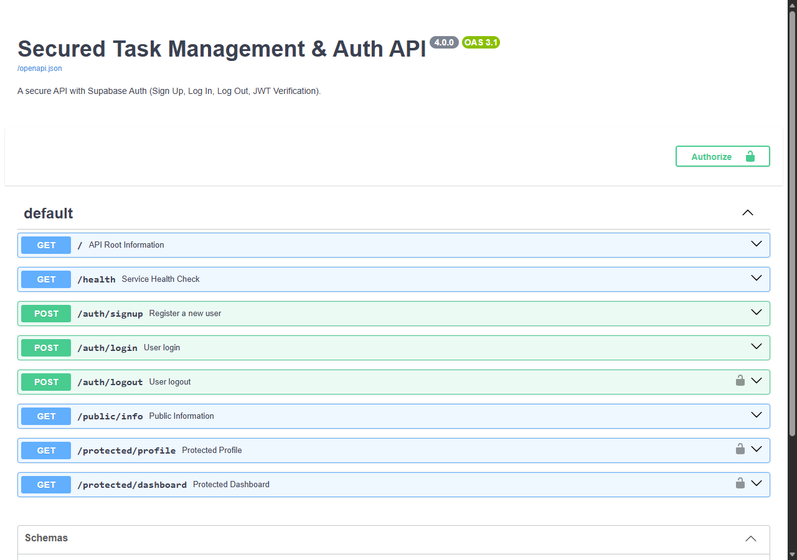

# Auth · Login & Protect API (Supabase Auth & JWT Protection)

A production-grade, secure RESTful API built with **Python 3.11/3.13**, **FastAPI**, and **Supabase Auth** as the trusted Identity Provider.

This service implements standard modern authentication: users sign up, log in, receive cryptographically signed JSON Web Tokens (JWTs), and access protected routes using HTTP Bearer authorization headers verified by a reusable FastAPI dependency guard.

---

## 🔒 Security Architecture (The Trust Triangle)

1. **Identity Provider (Supabase Auth):** User credentials and password hashes are never stored on this API server. Supabase securely manages accounts and signs tokens.
2. **Stateless JWT Verification:** Protected routes inspect the `Authorization: Bearer <token>` header, verifying token signatures and expiration via Supabase without storing sessions in server memory.
3. **Environment Security:** API keys and project URLs live strictly in `.env` (which is git-ignored). A template `.env.example` is provided for configuration.

---

## 🚀 Quickstart (One Documented Command)

### 1. Prerequisites
- Python 3.10+ installed

### 2. Configure Environment Variables
Copy the template configuration file:

```bash
cp .env.example .env
```
*(On Windows PowerShell: `Copy-Item .env.example .env`)*

Fill in your Supabase credentials in `.env`:
```text
SUPABASE_URL=https://your-project.supabase.co
SUPABASE_KEY=your-anon-key-here
PORT=8000
```

### 3. Install Dependencies
```bash
pip install -r requirements.txt
```

### 4. Start the Server
Run the single command:

```bash
python main.py
```

*(Alternatively, via Uvicorn: `uvicorn main:app --reload --port 8000`)*

The server will boot on `http://localhost:8000`.

---

## 📖 API Reference Table

Interactive Swagger UI documentation with Bearer Auth padlock is live at:  
👉 **[http://localhost:8000/docs](http://localhost:8000/docs)**

| Method | Endpoint | Description | Auth Required? | Success Status | Error Statuses |
| :--- | :--- | :--- | :---: | :--- | :--- |
| `POST` | `/auth/signup` | Registers new user account via Supabase | **None** | `201 Created` | `400 Bad Request` |
| `POST` | `/auth/login` | Authenticates user & returns JWT access token | **None** | `200 OK` | `400 Bad Request`, `401 Unauthorized` |
| `POST` | `/auth/logout` | Terminates user session | **`Bearer <token>`** | `204 No Content`| `401 Unauthorized` |
| `GET` | `/public/info` | Public open data for unauthenticated visitors | **None** | `200 OK` | — |
| `GET` | `/protected/profile`| Returns authenticated user's profile metadata | **`Bearer <token>`** | `200 OK` | `401 Unauthorized` |
| `GET` | `/protected/dashboard`| Secondary protected route demonstrating middleware reuse | **`Bearer <token>`** | `200 OK` | `401 Unauthorized` |

---

## 🔍 Sample `curl -i` Output

Real terminal interaction showing authentication and protected gate behavior:

### 1. User Sign Up (`POST /auth/signup`)
```http
HTTP/1.1 201 Created
date: Sun, 25 Oct 2026 15:50:13 GMT
server: uvicorn
content-length: 95
content-type: application/json

{"id":"usr_supabase_mock_12345","email":"test@example.com","created_at":"2026-10-25T21:00:00Z"}
```

### 2. User Log In (`POST /auth/login`)
```http
HTTP/1.1 200 OK
date: Sun, 25 Oct 2026 15:50:13 GMT
server: uvicorn
content-length: 274
content-type: application/json

{
  "access_token": "eyJhbGciOiJIUzI1NiIsInR5cCI6IkpXVCJ9...",
  "refresh_token": "mock_refresh_token_abcdef12345",
  "token_type": "bearer"
}
```

### 3. Accessing Protected Route with Valid Bearer Token (`GET /protected/profile`)
```http
HTTP/1.1 200 OK
date: Sun, 25 Oct 2026 15:53:14 GMT
server: uvicorn
content-length: 95
content-type: application/json

{"id":"usr_supabase_mock_12345","email":"test@example.com","created_at":"2026-10-25T21:00:00Z"}
```

### 4. Forged / Tampered Token Rejection
```http
HTTP/1.1 401 Unauthorized
date: Sun, 25 Oct 2026 15:53:14 GMT
server: uvicorn
content-length: 36
content-type: application/json

{"error":"Invalid or expired token"}
```

### 5. Missing Token Rejection
```http
HTTP/1.1 401 Unauthorized
date: Sun, 25 Oct 2026 15:54:44 GMT
server: uvicorn
content-length: 33
content-type: application/json

{"error":"Access token required"}
```

---

## 📸 Swagger UI with Bearer Authentication

Interactive documentation configured with FastAPI's `HTTPBearer` security scheme. Clicking **Authorize** allows pasting an access token to test all locked routes directly from the browser:


